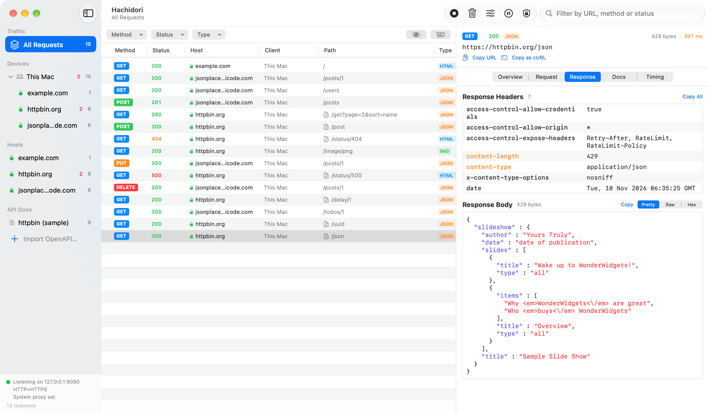
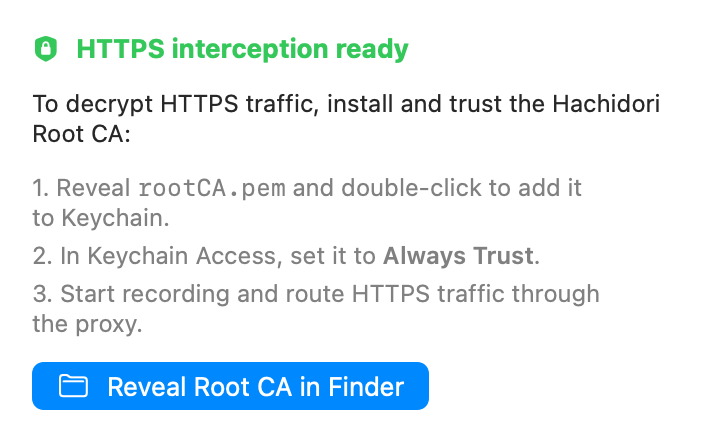
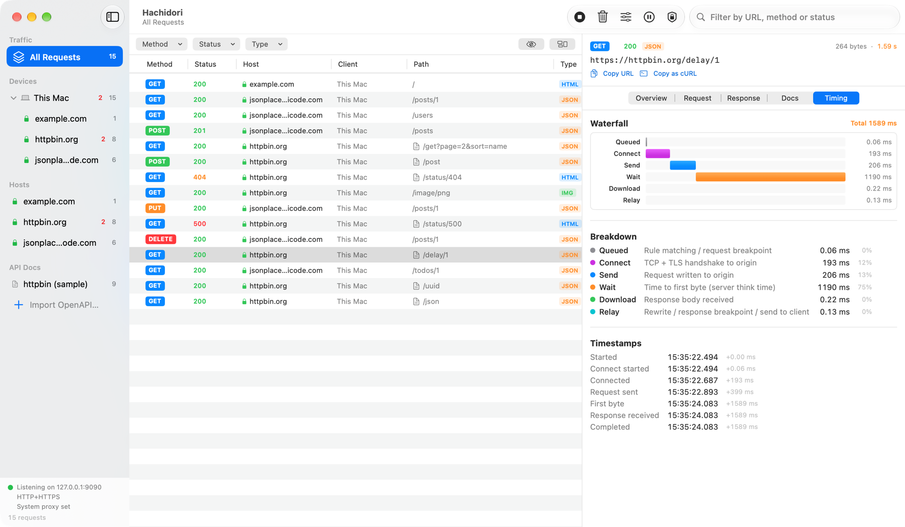
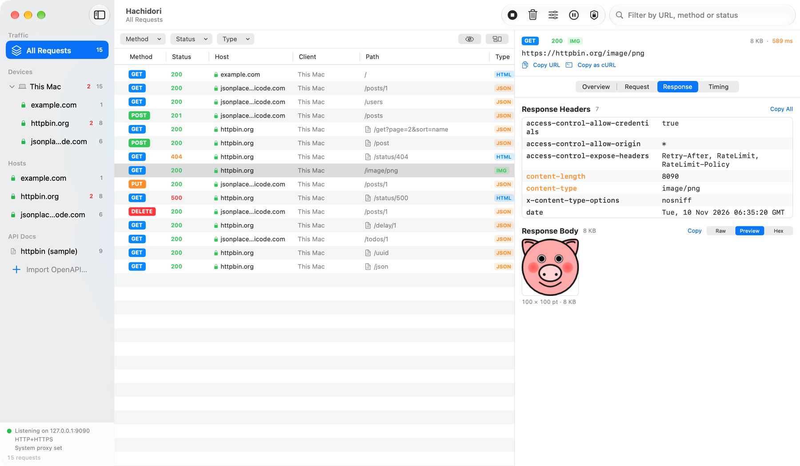
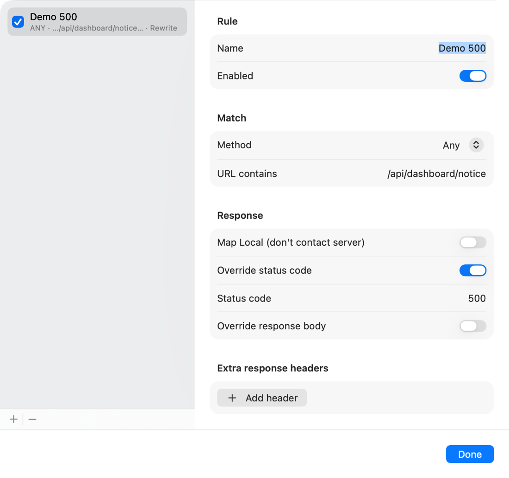
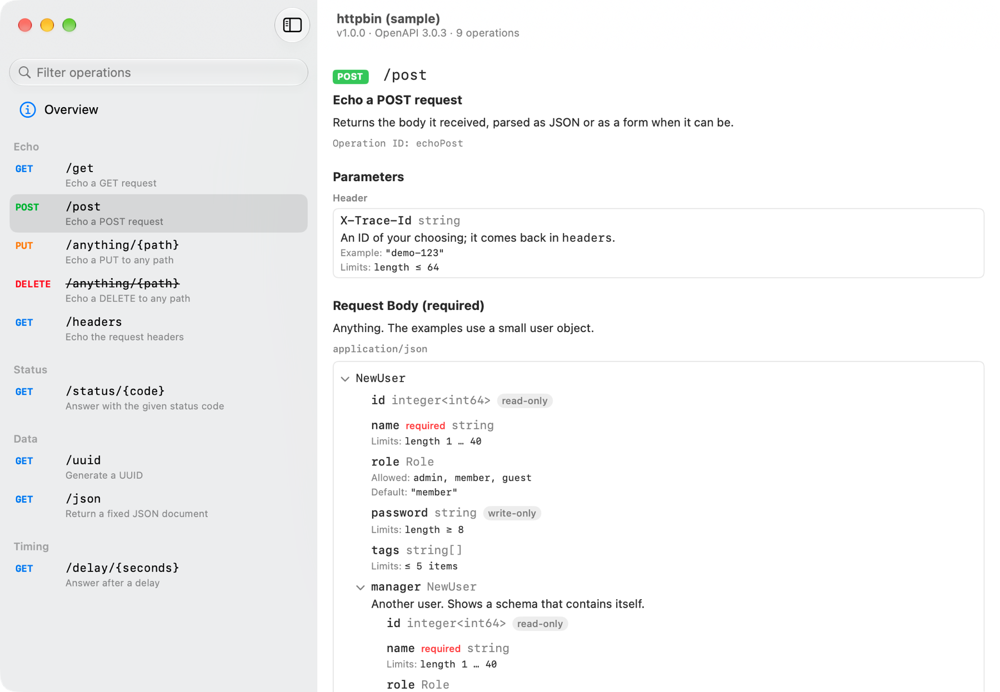
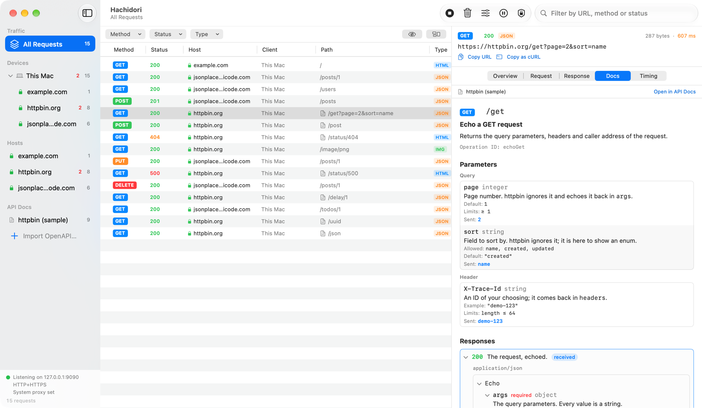

<div align="center">


# Hachidori

**macOS ネイティブの HTTP/HTTPS デバッグプロキシ。**<br>
アプリや Web サイトが送るすべてのリクエストを確認し、レスポンスを調べ、その場で書き換えられます。

[](https://github.com/Ekko0701/Hachidori/releases/latest)
[](https://github.com/Ekko0701/Hachidori/releases)


[](LICENSE)

[English](README.md) · [한국어](README.ko.md) · **日本語** · [简体中文](README.zh-CN.md)

</div>



- **HTTP と HTTPS をキャプチャ**: この Mac だけでなく、同じネットワーク上のスマートフォンやタブレットの通信も記録できます。
- **細部まで確認**: ヘッダ、整形されたボディ、画像・HTML のプレビュー、タイミングのウォーターフォールを表示します。
- **通信を書き換え**: ルールでレスポンスを書き換えたり、リクエストを一時停止して手で編集したりできます。
- **API ドキュメントと連携**: OpenAPI ドキュメントを読み込むと、各リクエストの横にそのドキュメントを表示します。
- **ネイティブでローカル**: 署名・公証済みの Mac アプリです。キャプチャした内容が Mac の外に出ることはありません。

> アプリの画面は英語で表示されます。この文書の**太字**の英語は、画面に表示される名前そのままです。

## インストール

Hachidori は **macOS 14 以降**で動作し、Apple シリコンと Intel の Mac に対応しています。

1. [最新リリース](https://github.com/Ekko0701/Hachidori/releases/latest)から
   `Hachidori-<バージョン>.dmg` をダウンロードします。
2. DMG を開き、**Hachidori** を**アプリケーション**フォルダにドラッグします。
3. アプリケーションフォルダから Hachidori を開きます。

リリースは Apple の署名と公証を受けているため、セキュリティ警告なしで開きます。

### アップデート

Hachidori は起動時と、その後数時間おきに GitHub で新しいリリースを確認します。新しい
バージョンがあると、ツールバーに **Update** ボタンが表示されます。ボタンをクリックして
**Restart to Update** を選ぶと、新しいバージョンをダウンロードし、同じ開発者の署名である
ことを確認してから再起動します。**Hachidori → Check for Updates…** ですぐに確認することも
できます。

その場でのアップデートには、アプリがアプリケーションフォルダのような書き込み可能な場所に
ある必要があります。0.1.3 より前のバージョンにはアップデート機能がないため、最新の DMG を
一度上書きインストールしてください。

### アンインストール

Hachidori をゴミ箱に移動します。保存されたデータもすべて削除するには、
`~/Library/Application Support/Hachidori` フォルダを削除し、キーチェーンアクセスに追加して
いた場合は **Hachidori Root CA** も削除してください。

## 使い方

### 1. 記録を開始する

1. ツールバーの **Record** をクリックするか、⌘R を押します。
2. いつものようにブラウザやアプリを使います。リクエストが発生するたびに一覧に表示されます。
3. 終わったら **Stop**(もう一度 ⌘R)を押します。⌘K で一覧を消去できます。

記録中、Hachidori はこの Mac の HTTP・HTTPS プロキシを自分自身に向け、サイドバー下部の
ステータスに待ち受けているアドレスを表示します。記録を止めるかアプリを終了すると、元の
プロキシ設定に戻します。Hachidori が予期せず終了した場合も、次に開いたときに元に戻します。

プロキシを自分で管理したい場合は、**Certificate** ポップオーバーで
**Auto-configure macOS system proxy** をオフにし、アプリのプロキシを `127.0.0.1:9090` に
設定してください。

この段階では平文の HTTP だけが読めます。HTTPS のリクエストも一覧に表示されますが、次の
手順を終えるまでは暗号化されたままです。

### 2. Root CA を信頼して HTTPS を読む

HTTPS の通信を表示するには Hachidori が復号する必要があり、そのためには Mac が Hachidori の
証明書を信頼している必要があります。この設定は一度だけです。



1. ツールバーの **Certificate** ボタン(盾のアイコン)をクリックします。
2. **Reveal Root CA in Finder** をクリックし、`rootCA.pem` をダブルクリックしてログイン
   キーチェーンに追加します。
3. キーチェーンアクセスで **Hachidori Root CA** を開き、**信頼**を展開して、
   **この証明書を使用するとき**を**常に信頼**に設定します。macOS がパスワードを求めます。
4. もう一度記録を開始します。HTTPS のリクエストに緑の鍵が付き、内容がすべて表示されます。

Root CA はインストールごとに新しく作られます。秘密鍵は
`~/Library/Application Support/Hachidori` の外に出ることはなく、自分のユーザアカウントだけが
読み取れます。

独自の証明書リストを持ち、キーチェーンを参照しないツールもあります。そうしたツールには
証明書を直接指定してください。例:

```bash
curl -x http://127.0.0.1:9090 --cacert ~/Library/Application\ Support/Hachidori/rootCA.pem https://httpbin.org/get
```

あるホストが CONNECT エラーで失敗し続ける場合は、そのホストと通信しているアプリがまだ
証明書を信頼していないか、独自の証明書をピン留めしています。フィルタバーの目のボタンで
そうした行を隠せます。

### 3. 目的のリクエストを探す

- **サイドバー**: デバイスまたはホストを選ぶと、そのリクエストだけが表示されます。赤い数字は
  失敗したリクエストと 4xx/5xx レスポンスの数です。
- **フィルタバー**: メソッド、ステータスの種類、コンテンツタイプで一覧を絞り込みます。
- **検索フィールド**: URL、メソッド、ステータスコードで検索します。
- **Group by Host**(フィルタバー右側のボタン): 一覧をホストごとにまとめます。

### 4. リクエストを調べる

リクエストを選択すると、右側のインスペクタに表示されます。

- **Overview**: URL、メソッド、ステータス、コンテンツタイプ、サイズをひと目で確認できます。
- **Request** と **Response**: ヘッダとボディを表示します。ボディは **Pretty**(整形・色分け)、
  **Raw**、**Preview**(画像と HTML)、**Hex** から選べます。圧縮されたボディは展開して
  表示します。
- **Timing**: リクエストを接続、送信、待機、ダウンロードに分け、ウォーターフォールで表示します。
- **Messages**: WebSocket 接続のときに表示され、送受信したフレームを一つずつ表示します。

インスペクタ上部の **Copy URL** と **Copy as cURL** で、同じリクエストをターミナルから
もう一度送れます。





### 5. スマートフォンやタブレットをキャプチャする

1. デバイスと Mac を同じ Wi-Fi ネットワークに接続します。
2. **Certificate** ポップオーバーで **Test on physical devices (LAN)** をオンにし、記録を
   一度止めてから再開します。
3. デバイスの Wi-Fi 設定で、HTTP プロキシをポップオーバーに表示されたアドレスに設定します。
4. デバイスのブラウザで同じアドレスを開いて Root CA をダウンロードし、インストールして
   完全な信頼を有効にします。

デバイスはそれぞれ、通信したホストとともにサイドバーの **Devices** の下に表示されます。
iOS、Android、Flutter ごとの詳細は[実機テストガイド](docs/device-testing.md)(韓国語)を
参照してください。

### 6. レスポンスを書き換える

**Rules** は条件に合うレスポンスを自動で書き換えます。ツールバーの **Rules** をクリック
してルールを追加し、何に適用するか(メソッドと URL に含まれる文字列)と何をするかを決めます。
ステータスコード、ボディ、ヘッダを置き換えたり、サーバに接続せずローカルで応答
(**Map Local**)させたりできます。



**Breakpoints** は通信を一時停止して、手で書き換えられるようにします。ツールバーの
**Breakpoints** をクリックし、リクエスト、レスポンス、またはその両方を止めるよう設定します。
必要なら、特定の文字列を含む URL だけに絞れます。止まったリクエストやレスポンスは編集画面で
開きます。**Send** を押すと変更した内容で続行し、**Abort** を押すと接続を切断します。
テキストの本文はその場で編集できます。ファイルのダウンロードや画像などのバイナリ本文は
**Replace with Text** で入力したテキストに、どの本文も **Replace with File…** で Mac 上の
ファイルに差し替えて送れます。

ルールとブレークポイントの URL フィルタは、次回起動時にも残ります。ブレークポイントの
スイッチは常にオフの状態で始まるため、自分でオンにするまで通信が止まることはありません。

### 7. リクエストの API ドキュメントを見る

**File → Import OpenAPI…**(⇧⌘I)で OpenAPI 3.0 または 3.1 のドキュメント(YAML、JSON)を
読み込むか、ファイルをウインドウにドロップします。ドキュメントはサイドバーの **API Docs** の
下に表示されます。クリックすると別ウインドウが開き、タグごとにまとめられたオペレーションを
見られます。



キャプチャしたリクエストがドキュメントのオペレーションに一致すると、パスの横にドキュメントの
アイコンが付き、インスペクタに **Docs** タブが現れます。このタブは、オペレーションの
パラメータと、リクエストが実際に送った値を並べて表示し、返ってきたレスポンスに印を付けます。
**Open in API Docs** をクリックすると、ドキュメントのウインドウでそのオペレーションに
移動します。



ドキュメントには本番サーバしか書かれておらず、実際の通信は開発サーバに向かうことがよく
あります。ドキュメントの **Overview** 画面で、**Hosts** に適用するホストを指定してください。
`*.example.com` はすべてのサブドメインに一致します。

試すには、httpbin.org の一部を記述した
[docs/samples/httpbin-openapi.yaml](docs/samples/httpbin-openapi.yaml) を読み込み、
リクエストを送ってみてください。

```bash
curl -x http://127.0.0.1:9090 --cacert ~/Library/Application\ Support/Hachidori/rootCA.pem "https://httpbin.org/get?page=2&sort=name"
```

### キーボードショートカット

| ショートカット | 動作 |
|---|---|
| ⌘R | 記録の開始・停止 |
| ⌘K | キャプチャしたリクエストを消去 |
| ⇧⌘I | OpenAPI ドキュメントを読み込む |

## 開発

ソースからのビルド方法、プロジェクトの構成、リリース手順は
[docs/development.md](docs/development.md)(英語)にあります。

## ライセンス

[MIT](LICENSE) © 2026 Ekko0701
