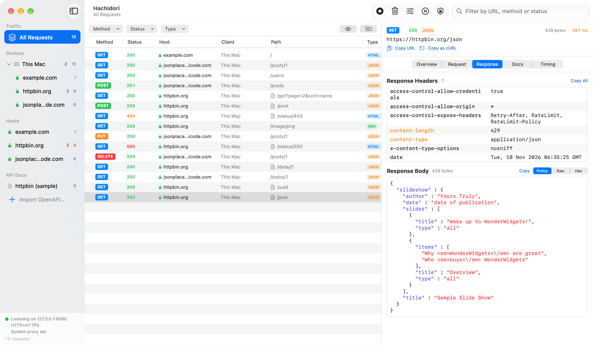
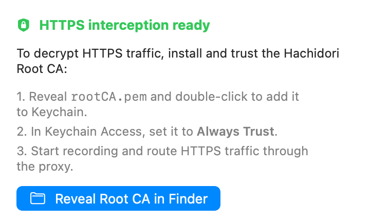
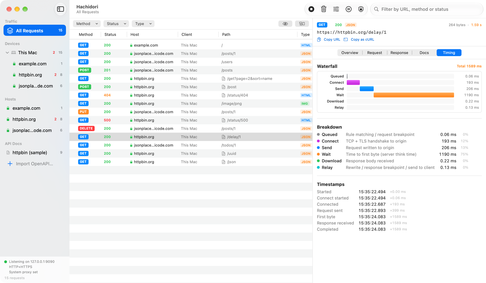
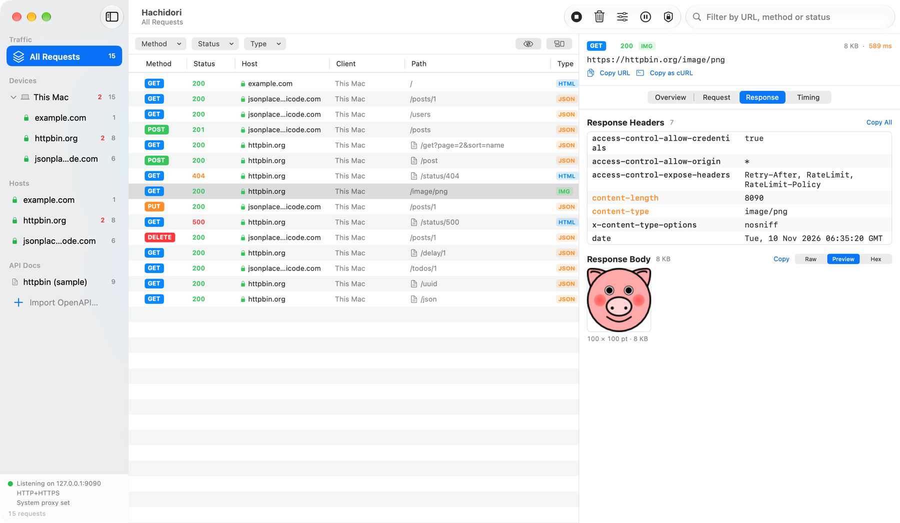
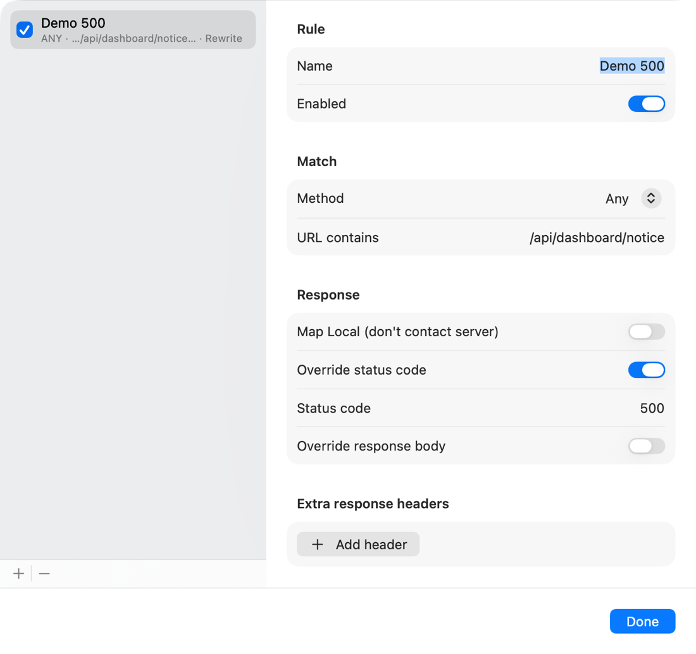
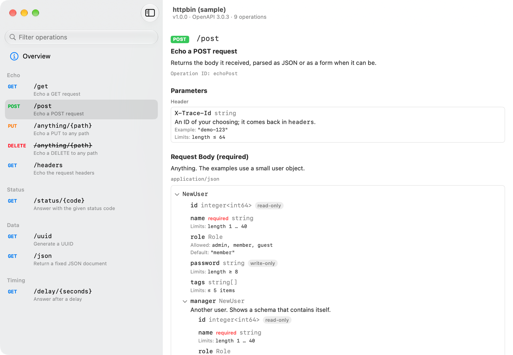
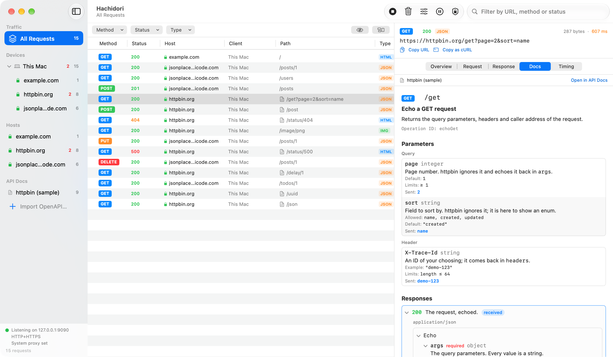

<div align="center">


# Hachidori

**macOS용 네이티브 HTTP/HTTPS 디버깅 프록시.**<br>
앱과 웹사이트가 보내는 모든 요청을 보고, 응답을 살펴보고, 그 자리에서 바꿔 볼 수 있습니다.

[](https://github.com/Ekko0701/Hachidori/releases/latest)
[](https://github.com/Ekko0701/Hachidori/releases)


[](LICENSE)

[English](README.md) · **한국어** · [日本語](README.ja.md) · [简体中文](README.zh-CN.md)

</div>



- **HTTP와 HTTPS 캡처**: 이 Mac은 물론, 같은 네트워크에 있는 휴대폰과 태블릿의 트래픽도 잡습니다.
- **모든 세부 정보**: 헤더, 보기 좋게 정리된 본문, 이미지·HTML 미리보기, 타이밍 워터폴을 보여 줍니다.
- **트래픽 변경**: 규칙으로 응답을 바꾸거나, 요청을 멈춰 세우고 직접 고칠 수 있습니다.
- **API 문서 연동**: OpenAPI 문서를 임포트하면 각 요청 옆에서 해당 문서를 볼 수 있습니다.
- **네이티브, 로컬**: 서명과 공증을 받은 Mac 앱입니다. 캡처한 내용은 Mac 밖으로 나가지 않습니다.

> 앱의 화면은 영어로 표시됩니다. 이 문서에서 **굵게** 쓴 영어는 화면에 보이는 이름 그대로입니다.

## 설치

Hachidori는 **macOS 14 이상**에서 동작하며, Apple Silicon과 Intel Mac을 모두 지원합니다.

1. [최신 릴리스](https://github.com/Ekko0701/Hachidori/releases/latest)에서
   `Hachidori-<버전>.dmg`를 내려받습니다.
2. DMG를 열고 **Hachidori**를 **응용 프로그램** 폴더로 끌어다 놓습니다.
3. 응용 프로그램 폴더에서 Hachidori를 엽니다.

릴리스는 Apple의 서명과 공증을 받았기 때문에 보안 경고 없이 열립니다.

### 업데이트

Hachidori는 시작할 때와 그 뒤 몇 시간마다 GitHub에서 새 릴리스를 확인합니다. 새 버전이
나오면 툴바에 **Update** 버튼이 나타납니다. 버튼을 누르고 **Restart to Update**를
선택하면 새 버전을 내려받아 같은 개발자가 서명했는지 확인한 뒤 다시 열립니다.
**Hachidori → Check for Updates…** 메뉴로 바로 확인할 수도 있습니다.

제자리 업데이트는 앱이 응용 프로그램 폴더처럼 쓰기 가능한 폴더에 있어야 합니다.
0.1.3보다 이전 버전에는 업데이트 기능이 없으므로, 최신 DMG를 한 번 덮어 설치해 주세요.

### 삭제

Hachidori를 휴지통으로 옮깁니다. 저장된 데이터까지 지우려면
`~/Library/Application Support/Hachidori` 폴더를 삭제하고, 키체인 접근에 추가했다면
**Hachidori Root CA**도 삭제합니다.

## 사용법

### 1. 녹화 시작하기

1. 툴바의 **Record**를 누르거나 ⌘R을 누릅니다.
2. 평소처럼 브라우저나 앱을 사용합니다. 요청이 발생하는 대로 목록에 나타납니다.
3. 끝나면 **Stop**(다시 ⌘R)을 누릅니다. ⌘K는 목록을 비웁니다.

녹화하는 동안 Hachidori는 이 Mac의 HTTP·HTTPS 프록시를 자신으로 설정하고, 사이드바 아래의
상태 표시에 수신 중인 주소를 보여 줍니다. 녹화를 멈추거나 앱을 종료하면 이전 프록시 설정으로
되돌립니다. Hachidori가 예기치 않게 종료되더라도 다음에 열 때 원래대로 복구합니다.

프록시를 직접 관리하려면 **Certificate** 팝오버에서
**Auto-configure macOS system proxy**를 끄고, 앱의 프록시를 `127.0.0.1:9090`으로 지정하세요.

이 단계까지는 일반 HTTP만 읽을 수 있습니다. HTTPS 요청도 목록에 나타나지만, 다음 단계를
마치기 전까지는 암호화된 상태로 남습니다.

### 2. Root CA를 신뢰해 HTTPS 읽기

HTTPS 트래픽을 보여 주려면 Hachidori가 복호화해야 하고, 그러려면 Mac이 Hachidori의
인증서를 신뢰해야 합니다. 한 번만 하면 됩니다.



1. 툴바의 **Certificate** 버튼(방패 모양)을 누릅니다.
2. **Reveal Root CA in Finder**를 누른 뒤, `rootCA.pem`을 더블클릭해 로그인 키체인에
   추가합니다.
3. 키체인 접근에서 **Hachidori Root CA**를 열고 **신뢰** 항목을 펼친 다음,
   **이 인증서 사용 시**를 **항상 신뢰**로 설정합니다. macOS가 암호를 묻습니다.
4. 다시 녹화를 시작합니다. 이제 HTTPS 요청에 초록색 자물쇠가 붙고 전체 내용이 보입니다.

Root CA는 설치할 때마다 새로 만들어집니다. 개인 키는
`~/Library/Application Support/Hachidori` 밖으로 나가지 않으며, 본인 계정만 읽을 수 있습니다.

일부 도구는 자체 인증서 목록을 쓰고 키체인을 보지 않습니다. 그런 도구에는 인증서를 직접
지정해 주세요. 예:

```bash
curl -x http://127.0.0.1:9090 --cacert ~/Library/Application\ Support/Hachidori/rootCA.pem https://httpbin.org/get
```

특정 호스트가 계속 CONNECT 오류로 실패한다면, 그 호스트와 통신하는 앱이 아직 인증서를
신뢰하지 않거나 자체 인증서를 고정(pinning)해 쓰는 것입니다. 필터 바의 눈 모양 버튼으로
그런 행을 숨길 수 있습니다.

### 3. 원하는 요청 찾기

- **사이드바**: 기기나 호스트를 선택하면 해당 요청만 보입니다. 빨간 숫자는 실패한 요청과
  4xx/5xx 응답의 개수입니다.
- **필터 바**: 메서드, 상태 코드 범위, 콘텐츠 유형으로 목록을 좁힙니다.
- **검색 필드**: URL, 메서드, 상태 코드로 찾습니다.
- **Group by Host**(필터 바 오른쪽 버튼): 목록을 호스트별로 묶어 보여 줍니다.

### 4. 요청 살펴보기

요청을 선택하면 오른쪽 인스펙터에 열립니다.

- **Overview**: URL, 메서드, 상태, 콘텐츠 유형, 크기를 한눈에 보여 줍니다.
- **Request**와 **Response**: 헤더와 본문을 보여 줍니다. 본문은 **Pretty**(정리·색상 표시),
  **Raw**, **Preview**(이미지와 HTML), **Hex** 중에서 골라 볼 수 있습니다. 압축된 본문은
  풀어서 보여 줍니다.
- **Timing**: 요청을 연결, 전송, 대기, 다운로드 구간으로 나눠 워터폴로 보여 줍니다.
- **Messages**: WebSocket 연결에서 나타나며, 주고받은 프레임을 하나씩 보여 줍니다.

인스펙터 위쪽의 **Copy URL**과 **Copy as cURL**로 같은 요청을 터미널에서 다시 보낼 수
있습니다.





### 5. 휴대폰·태블릿 캡처하기

1. 기기와 Mac을 같은 Wi-Fi 네트워크에 연결합니다.
2. **Certificate** 팝오버에서 **Test on physical devices (LAN)**을 켠 뒤, 녹화를 멈췄다가
   다시 시작합니다.
3. 기기의 Wi-Fi 설정에서 HTTP 프록시를 팝오버에 표시된 주소로 지정합니다.
4. 기기의 브라우저에서 같은 주소를 열어 Root CA를 내려받고, 설치한 뒤 전체 신뢰를 켭니다.

기기마다 사이드바의 **Devices** 아래에, 통신한 호스트와 함께 따로 나타납니다. iOS, Android,
Flutter별 자세한 내용은 [실기기 테스트 가이드](docs/device-testing.md)를 참고하세요.

### 6. 응답 바꾸기

**Rules**는 조건에 맞는 응답을 자동으로 바꿉니다. 툴바의 **Rules**를 눌러 규칙을 추가하고,
무엇에 적용할지(메서드, URL에 포함된 문자열)와 무엇을 할지 정합니다. 상태 코드, 본문, 헤더를
바꾸거나, 서버에 연결하지 않고 로컬에서 바로 응답(**Map Local**)하게 할 수 있습니다.



**Breakpoints**는 트래픽을 멈춰 세워 직접 고칠 수 있게 합니다. 툴바의 **Breakpoints**를
눌러 요청, 응답, 또는 둘 다를 멈추도록 설정하고, 필요하면 특정 문자열이 들어간 URL로
범위를 좁힙니다. 멈춘 요청이나 응답은 편집 화면으로 열립니다. **Send**를 누르면 고친
내용대로 계속 진행하고, **Abort**를 누르면 연결을 끊습니다. 텍스트 본문은 그 자리에서
고칠 수 있고, 파일 다운로드나 이미지 같은 본문도 **Replace with File…**로 Mac의 파일로
바꿔 보낼 수 있습니다.

규칙과 브레이크포인트 URL 필터는 앱을 다시 열어도 유지됩니다. 브레이크포인트 스위치는 항상
꺼진 상태로 시작하므로, 직접 켜기 전에는 트래픽이 멈추지 않습니다.

### 7. 요청의 API 문서 보기

**File → Import OpenAPI…**(⇧⌘I)로 OpenAPI 3.0 또는 3.1 문서(YAML, JSON)를 임포트하거나,
파일을 창에 끌어다 놓습니다. 문서는 사이드바의 **API Docs** 아래에 나타납니다. 클릭하면
별도 창이 열리고, 태그별로 묶인 operation을 둘러볼 수 있습니다.



캡처한 요청이 문서의 operation과 일치하면 경로 옆에 문서 아이콘이 붙고, 인스펙터에
**Docs** 탭이 생깁니다. 이 탭은 operation의 파라미터와 함께 요청이 실제로 보낸 값을 보여
주고, 돌아온 응답을 표시합니다. **Open in API Docs**를 누르면 문서 창에서 해당 operation으로
이동합니다.



문서에는 운영 서버만 적혀 있고 실제 트래픽은 개발 서버로 가는 경우가 많습니다. 문서의
**Overview** 화면에서 **Hosts**에 적용할 호스트를 지정하세요. `*.example.com`은 하위
도메인을 모두 포함합니다.

직접 해 보려면 httpbin.org의 일부를 설명하는
[docs/samples/httpbin-openapi.yaml](docs/samples/httpbin-openapi.yaml)을 임포트하고 요청을
보내 보세요.

```bash
curl -x http://127.0.0.1:9090 --cacert ~/Library/Application\ Support/Hachidori/rootCA.pem "https://httpbin.org/get?page=2&sort=name"
```

### 단축키

| 단축키 | 동작 |
|---|---|
| ⌘R | 녹화 시작·중지 |
| ⌘K | 캡처한 요청 목록 비우기 |
| ⇧⌘I | OpenAPI 문서 임포트 |

## 개발

소스에서 빌드하는 방법, 프로젝트 구조, 릴리스 절차는
[docs/development.md](docs/development.md)(영어)에 있습니다.

## 라이선스

[MIT](LICENSE) © 2026 Ekko0701
