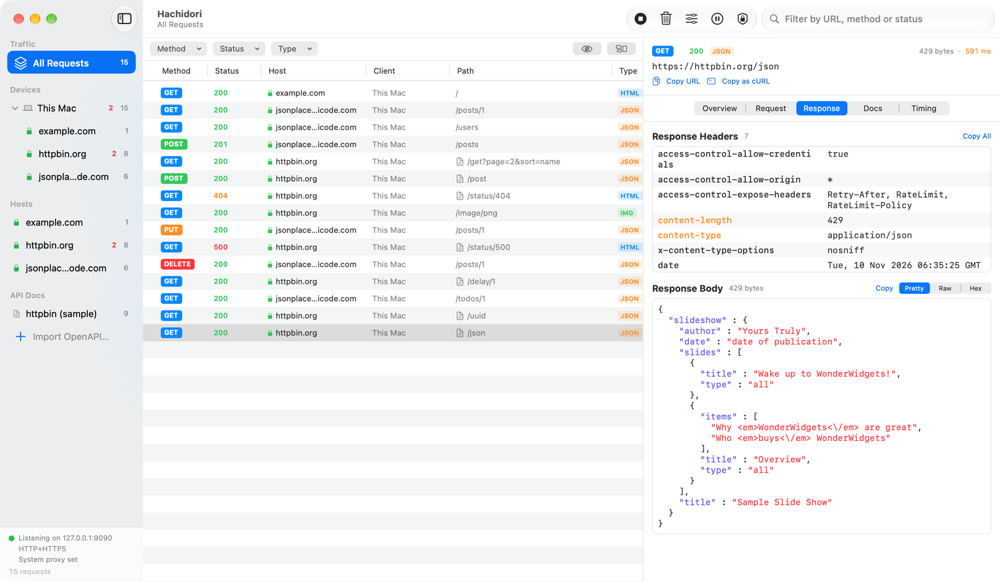
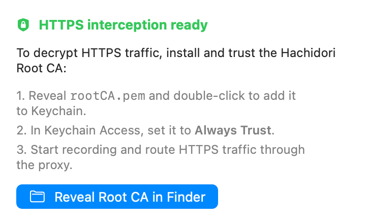
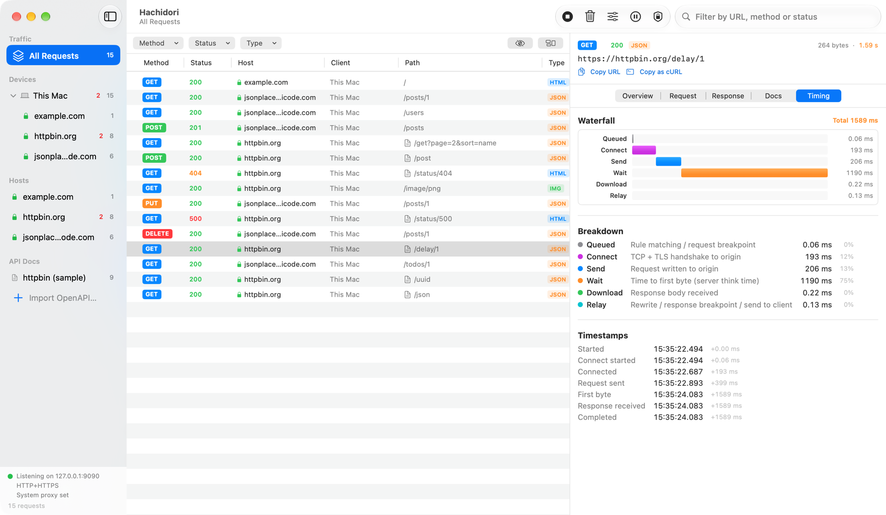
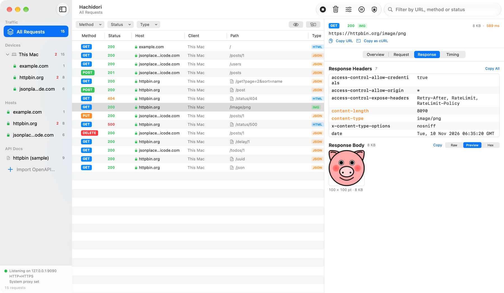
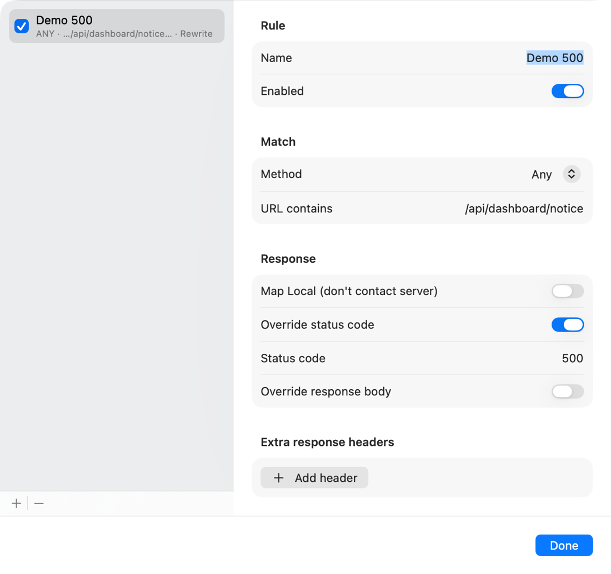
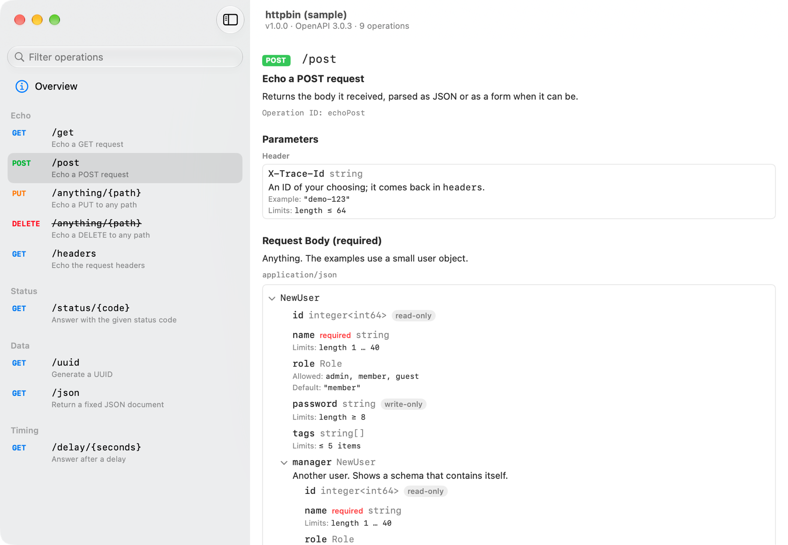
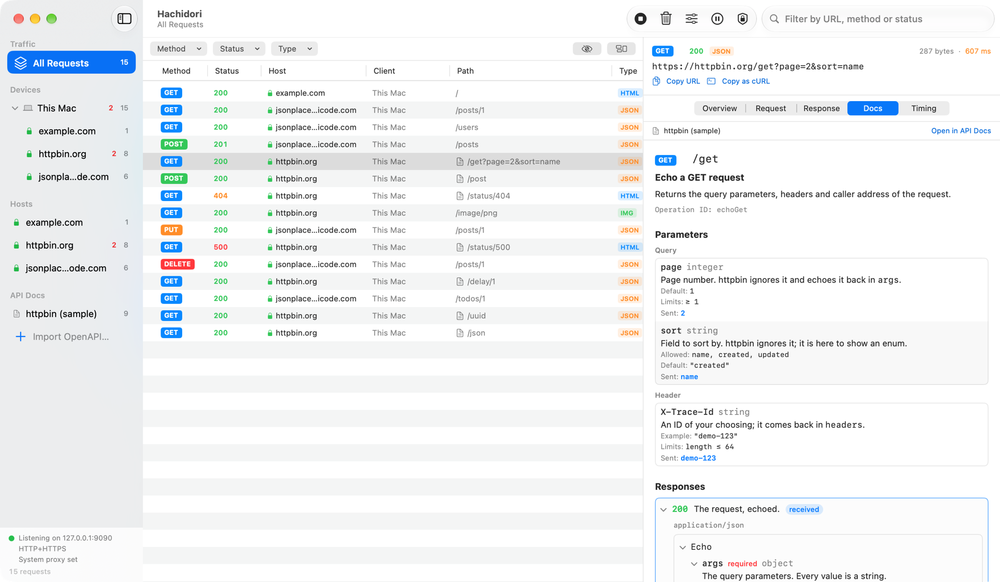

<div align="center">


# Hachidori

**A native macOS HTTP/HTTPS debugging proxy.**<br>
See every request your apps and websites make, inspect the responses, and change them on the fly.

[](https://github.com/Ekko0701/Hachidori/releases/latest)
[](https://github.com/Ekko0701/Hachidori/releases)


[](LICENSE)

**English** · [한국어](README.ko.md) · [日本語](README.ja.md) · [简体中文](README.zh-CN.md)

</div>



- **Captures HTTP and HTTPS** from this Mac, and from phones and tablets on the same network.
- **Shows every detail**: headers, pretty-printed bodies, image and HTML previews, a timing waterfall.
- **Changes traffic**: rewrite responses with rules, or pause a request and edit it by hand.
- **Knows your API**: import an OpenAPI document and see the documentation next to each request.
- **Native and local**: a signed, notarized Mac app. Nothing you capture leaves your Mac.

## Installation

Hachidori runs on **macOS 14 or later**, on Apple silicon and Intel Macs.

1. Download `Hachidori-<version>.dmg` from the
   [latest release](https://github.com/Ekko0701/Hachidori/releases/latest).
2. Open the DMG and drag **Hachidori** into **Applications**.
3. Open Hachidori from Applications.

Releases are signed and notarized by Apple, so the app opens without a security warning.

### Updating

Hachidori checks GitHub for new releases when it starts and every few hours after. When
one is out, an **Update** button appears in the toolbar. Click it and choose
**Restart to Update**: Hachidori downloads the new version, checks that it is signed by the
same developer, and reopens. **Hachidori → Check for Updates…** checks right away.

Updating in place needs the app to be in a folder you can write to, such as Applications.
Versions before 0.1.3 don't have the updater; install the latest DMG over them once.

### Uninstalling

Move Hachidori to the Trash. To remove everything it stored, also delete
`~/Library/Application Support/Hachidori`, and delete **Hachidori Root CA** from Keychain
Access if you added it.

## Usage

### 1. Start recording

1. Press **Record** in the toolbar, or ⌘R.
2. Use your browser or app as usual. Requests appear in the list as they happen.
3. Press **Stop** (⌘R again) when you are done. ⌘K clears the list.

While recording, Hachidori points this Mac's HTTP and HTTPS proxy at itself, and the
status at the bottom of the sidebar shows the address it is listening on. Stopping or
quitting puts your previous proxy settings back. If Hachidori ever quits unexpectedly, it
restores them the next time it opens.

To manage the proxy yourself, turn off **Auto-configure macOS system proxy** in the
**Certificate** popover and point your app at `127.0.0.1:9090`.

At this point plain HTTP is readable. HTTPS requests show up, but stay encrypted until you
finish the next step.

### 2. Trust the Root CA to read HTTPS

To show you HTTPS traffic, Hachidori has to decrypt it, and for that your Mac has to trust
Hachidori's certificate. You do this once.



1. Click the **Certificate** button in the toolbar (the shield).
2. Click **Reveal Root CA in Finder**, then double-click `rootCA.pem` to add it to your
   login keychain.
3. In Keychain Access, open **Hachidori Root CA**, expand **Trust**, and set
   **When using this certificate** to **Always Trust**. macOS asks for your password.
4. Start recording again. HTTPS requests now show a green lock and their full contents.

Each installation creates its own Root CA. Its private key never leaves
`~/Library/Application Support/Hachidori` and is readable only by your user account.

Some tools keep their own list of trusted certificates and ignore the keychain. Give those
the certificate directly, for example:

```bash
curl -x http://127.0.0.1:9090 --cacert ~/Library/Application\ Support/Hachidori/rootCA.pem https://httpbin.org/get
```

If a host keeps failing with a CONNECT error, the app talking to it doesn't trust the
certificate yet, or pins its own. The eye button in the filter bar hides those rows.

### 3. Find the request you want

- **Sidebar**: choose a device or a host to see only its requests. The red number counts
  failures and 4xx/5xx responses.
- **Filter bar**: narrow the list by method, status class or content type.
- **Search field**: matches the URL, method or status code.
- **Group by Host** (the button at the right of the filter bar) folds the list into one
  section per host.

### 4. Inspect a request

Select a request to open it in the inspector on the right.

- **Overview** shows the URL, method, status, content type and sizes at a glance.
- **Request** and **Response** show the headers and the body. Switch the body between
  **Pretty** (formatted and coloured), **Raw**, **Preview** (images and HTML) and **Hex**.
  Compressed bodies are decompressed for display.
- **Timing** breaks the request into connect, send, wait and download, with a waterfall.
- **Messages** appears for WebSocket connections and lists each frame sent and received.

**Copy URL** and **Copy as cURL** at the top of the inspector let you repeat a request in
the terminal.





### 5. Capture a phone or tablet

1. Connect the device and the Mac to the same Wi-Fi network.
2. In the **Certificate** popover, turn on **Test on physical devices (LAN)**, then stop
   and start recording.
3. On the device, set the Wi-Fi network's HTTP proxy to the address the popover shows.
4. On the device, open that same address in the browser to download the Root CA, then
   install it and turn on full trust for it.

Each device appears under **Devices** in the sidebar with the hosts it talked to. For iOS,
Android and Flutter details, see the [device testing guide](docs/device-testing.md)
(Korean).

### 6. Change responses

**Rules** change matching responses automatically. Click **Rules** in the toolbar, add a
rule, and choose what it matches (method and part of the URL) and what it does: replace
the status code, the body or headers, or answer locally without contacting the server
(**Map Local**).



**Breakpoints** pause traffic so you can change it by hand. Click **Breakpoints** in the
toolbar, choose to pause requests, responses or both, and optionally limit them to URLs
containing some text. A paused request or response opens in an editor; press **Send** to
let it continue with your changes, or **Abort** to drop the connection.

Rules and the breakpoint URL filter are saved between launches. The breakpoint switches
always start off, so traffic never pauses until you turn them on.

### 7. See the API documentation for a request

Import an OpenAPI 3.0 or 3.1 document (YAML or JSON) with **File → Import OpenAPI…**
(⇧⌘I), or drop the file on the window. It appears under **API Docs** in the sidebar.
Click it to browse its operations in a separate window, grouped by tag.



When a captured request matches an operation in the document, a document icon appears
beside its path and the inspector gains a **Docs** tab. The tab shows the operation's
parameters with the values the request actually sent, and marks the response that came
back. **Open in API Docs** jumps to the operation in the document's window.



Documents often list only production servers while your traffic goes to a development
one. Open the document's **Overview** page and set **Hosts** to the hosts it should apply
to; `*.example.com` covers subdomains.

To try it, import
[docs/samples/httpbin-openapi.yaml](docs/samples/httpbin-openapi.yaml), which describes
part of httpbin.org, and send a request:

```bash
curl -x http://127.0.0.1:9090 --cacert ~/Library/Application\ Support/Hachidori/rootCA.pem "https://httpbin.org/get?page=2&sort=name"
```

### Keyboard shortcuts

| Shortcut | Action |
|---|---|
| ⌘R | Start or stop recording |
| ⌘K | Clear the captured requests |
| ⇧⌘I | Import an OpenAPI document |

## Development

Building from source, the project layout and the release process are described in
[docs/development.md](docs/development.md).

## License

[MIT](LICENSE) © 2026 Ekko0701
