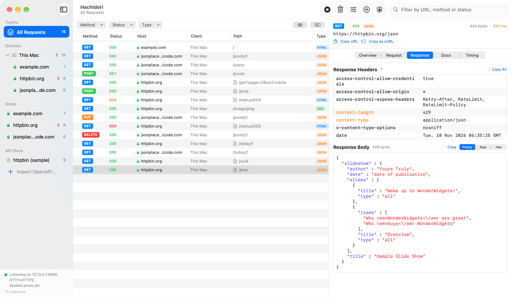
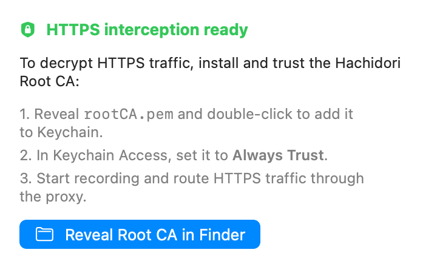
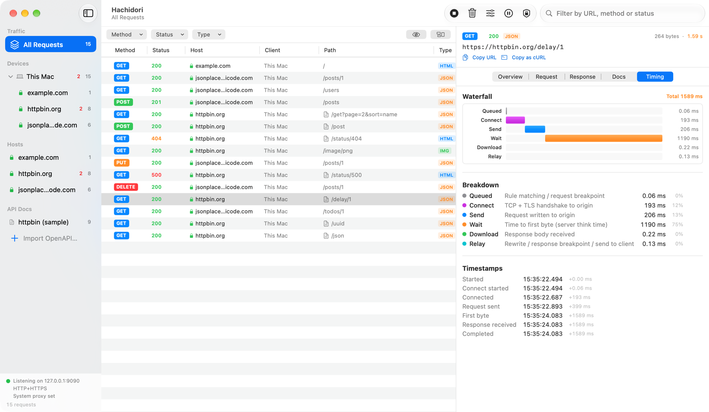
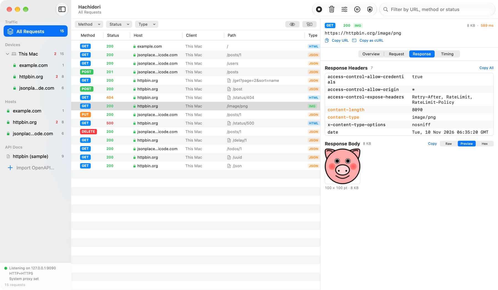
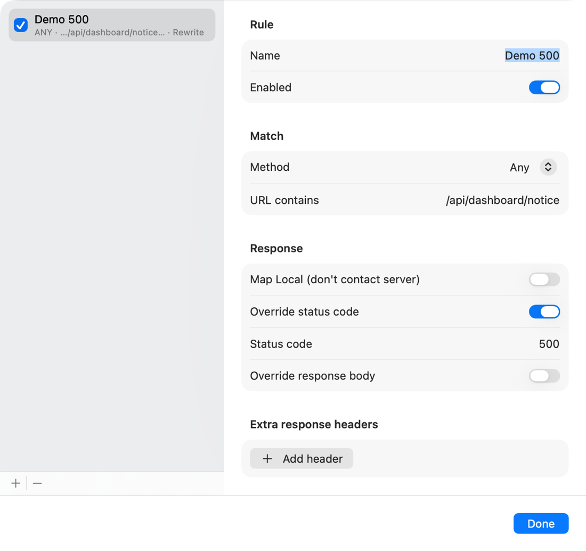
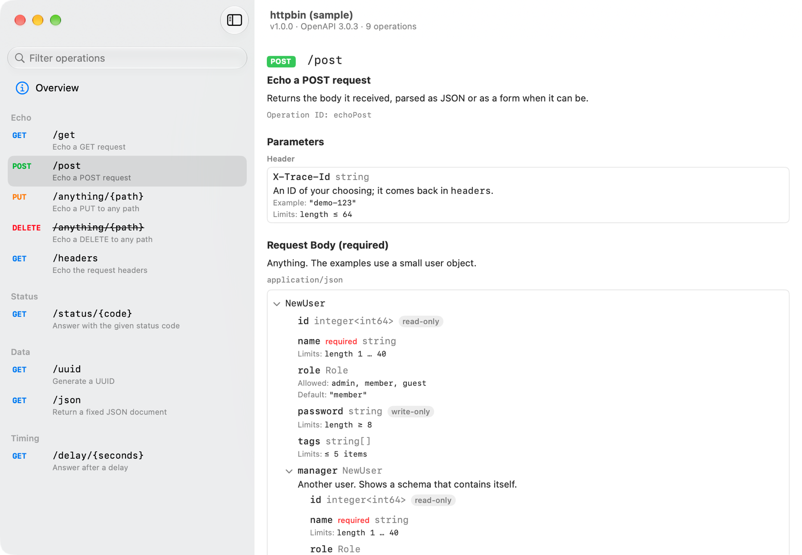
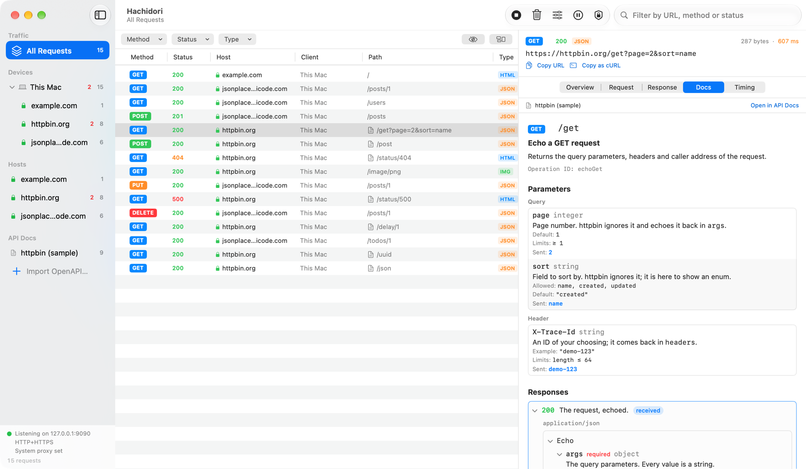

<div align="center">


# Hachidori

**macOS 原生的 HTTP/HTTPS 调试代理。**<br>
查看应用和网站发出的每一个请求，检查响应，并随时修改它们。

[](https://github.com/Ekko0701/Hachidori/releases/latest)
[](https://github.com/Ekko0701/Hachidori/releases)


[](LICENSE)

[English](README.md) · [한국어](README.ko.md) · [日本語](README.ja.md) · **简体中文**

</div>



- **捕获 HTTP 和 HTTPS**：不仅是这台 Mac，还包括同一网络中的手机和平板的流量。
- **查看全部细节**：请求头、格式化后的正文、图片和 HTML 预览、耗时瀑布图。
- **修改流量**：用规则改写响应，或者暂停请求后手动编辑。
- **了解你的 API**：导入 OpenAPI 文档后，可以在每个请求旁边看到对应的文档。
- **原生且本地**：经过签名和公证的 Mac 应用。捕获的内容不会离开你的 Mac。

> 应用界面为英文。本文中**加粗**的英文就是界面上显示的名称。

## 安装

Hachidori 可在 **macOS 14 及以上**版本运行，支持 Apple 芯片和 Intel 的 Mac。

1. 从[最新版本](https://github.com/Ekko0701/Hachidori/releases/latest)下载
   `Hachidori-<版本>.dmg`。
2. 打开 DMG，把 **Hachidori** 拖到**应用程序**文件夹。
3. 从应用程序文件夹打开 Hachidori。

发布版本经过 Apple 签名和公证，打开时不会出现安全警告。

### 更新

Hachidori 在启动时以及之后每隔几小时会到 GitHub 检查新版本。有新版本时，工具栏会出现
**Update** 按钮。点击它并选择 **Restart to Update**，Hachidori 会下载新版本，确认它由
同一开发者签名，然后重新打开。也可以通过 **Hachidori → Check for Updates…** 立即检查。

原地更新要求应用位于可写入的文件夹中，例如应用程序文件夹。0.1.3 之前的版本没有更新功能，
请用最新的 DMG 覆盖安装一次。

### 卸载

把 Hachidori 移到废纸篓。如果要删除它保存的全部数据，还需删除
`~/Library/Application Support/Hachidori` 文件夹；如果曾把 **Hachidori Root CA** 添加到
钥匙串访问，也请将其删除。

## 使用方法

### 1. 开始录制

1. 点击工具栏的 **Record**，或按 ⌘R。
2. 像平常一样使用浏览器或应用。请求会在发生时出现在列表中。
3. 完成后点击 **Stop**（再按一次 ⌘R）。⌘K 可清空列表。

录制期间，Hachidori 会把这台 Mac 的 HTTP 和 HTTPS 代理指向自己，侧边栏底部的状态会显示
它正在监听的地址。停止录制或退出应用后，会恢复你原来的代理设置。如果 Hachidori 意外退出，
下次打开时也会恢复这些设置。

如果想自己管理代理，请在 **Certificate** 弹出窗口中关闭
**Auto-configure macOS system proxy**，并把应用的代理设为 `127.0.0.1:9090`。

到这一步只能读取明文 HTTP。HTTPS 请求也会出现在列表中，但在完成下一步之前仍是加密的。

### 2. 信任 Root CA 以读取 HTTPS

要显示 HTTPS 流量，Hachidori 必须对其解密，这需要你的 Mac 信任 Hachidori 的证书。
只需设置一次。



1. 点击工具栏的 **Certificate** 按钮（盾牌图标）。
2. 点击 **Reveal Root CA in Finder**，然后双击 `rootCA.pem`，把它添加到登录钥匙串。
3. 在钥匙串访问中打开 **Hachidori Root CA**，展开**信任**，把**使用此证书时**设为
   **始终信任**。macOS 会要求输入密码。
4. 重新开始录制。现在 HTTPS 请求会带有绿色的锁，并显示完整内容。

每次安装都会生成自己的 Root CA。它的私钥不会离开
`~/Library/Application Support/Hachidori`，并且只有你的用户账户可以读取。

有些工具使用自己的受信任证书列表，不查看钥匙串。对这类工具请直接指定证书，例如：

```bash
curl -x http://127.0.0.1:9090 --cacert ~/Library/Application\ Support/Hachidori/rootCA.pem https://httpbin.org/get
```

如果某个主机一直以 CONNECT 错误失败，说明与它通信的应用还没有信任该证书，或者使用了
证书固定（pinning）。过滤栏中的眼睛按钮可以隐藏这些行。

### 3. 找到想看的请求

- **侧边栏**：选择设备或主机，只显示它的请求。红色数字是失败的请求和 4xx/5xx 响应的数量。
- **过滤栏**：按方法、状态码类别或内容类型缩小列表。
- **搜索框**：按 URL、方法或状态码查找。
- **Group by Host**（过滤栏右侧的按钮）：把列表按主机分组。

### 4. 检查请求

选中一个请求，它会在右侧的检查器中打开。

- **Overview**：一眼看到 URL、方法、状态、内容类型和大小。
- **Request** 和 **Response**：显示请求头和正文。正文可在 **Pretty**（格式化并着色）、
  **Raw**、**Preview**（图片和 HTML）和 **Hex** 之间切换。压缩过的正文会解压后显示。
- **Timing**：把请求分为连接、发送、等待和下载几个阶段，并以瀑布图显示。
- **Messages**：在 WebSocket 连接中出现，逐条列出收发的帧。

检查器顶部的 **Copy URL** 和 **Copy as cURL** 可以让你在终端中重新发送同一个请求。





### 5. 捕获手机或平板

1. 把设备和 Mac 连接到同一个 Wi-Fi 网络。
2. 在 **Certificate** 弹出窗口中打开 **Test on physical devices (LAN)**，然后停止并重新
   开始录制。
3. 在设备的 Wi-Fi 设置中，把 HTTP 代理设为弹出窗口中显示的地址。
4. 在设备的浏览器中打开同一个地址，下载 Root CA，安装并启用完全信任。

每台设备都会和它访问过的主机一起，单独显示在侧边栏的 **Devices** 下。iOS、Android 和
Flutter 的详细说明请参阅[真机测试指南](docs/device-testing.md)（韩语）。

### 6. 修改响应

**Rules** 会自动改写符合条件的响应。点击工具栏的 **Rules**，添加一条规则，然后设置它匹配
什么（方法和 URL 中包含的文本）以及做什么：替换状态码、正文或响应头，或者不连接服务器、
直接在本地应答（**Map Local**）。



**Breakpoints** 会暂停流量，让你手动修改。点击工具栏的 **Breakpoints**，选择暂停请求、
响应或两者，还可以把范围限定为包含某段文本的 URL。被暂停的请求或响应会在编辑器中打开：
点击 **Send** 让它带着你的修改继续，点击 **Abort** 则断开连接。文本正文可以直接编辑；
文件下载、图片等二进制正文可以用 **Replace with Text** 换成你输入的文本，任何正文都可以用
**Replace with File…** 换成 Mac 上的文件再发送。

规则和断点的 URL 过滤条件会在下次启动时保留。断点开关每次都从关闭状态开始，所以在你
打开它之前流量不会被暂停。

### 7. 查看请求对应的 API 文档

通过 **File → Import OpenAPI…**（⇧⌘I）导入 OpenAPI 3.0 或 3.1 文档（YAML 或 JSON），
或者把文件拖到窗口上。文档会出现在侧边栏的 **API Docs** 下。点击它会打开单独的窗口，
可以按标签分组浏览其中的操作（operation）。



当捕获的请求与文档中的某个操作匹配时，它的路径旁会出现文档图标，检查器也会多出一个
**Docs** 标签页。该标签页显示这个操作的参数以及请求实际发送的值，并标出返回的响应。
点击 **Open in API Docs** 可跳转到文档窗口中的该操作。



文档里常常只列出生产服务器，而实际流量发往开发服务器。打开文档的 **Overview** 页面，
在 **Hosts** 中填写它应适用的主机；`*.example.com` 可匹配所有子域名。

想试用的话，可以导入描述了 httpbin.org 一部分接口的
[docs/samples/httpbin-openapi.yaml](docs/samples/httpbin-openapi.yaml)，然后发送一个请求：

```bash
curl -x http://127.0.0.1:9090 --cacert ~/Library/Application\ Support/Hachidori/rootCA.pem "https://httpbin.org/get?page=2&sort=name"
```

### 键盘快捷键

| 快捷键 | 操作 |
|---|---|
| ⌘R | 开始或停止录制 |
| ⌘K | 清空已捕获的请求 |
| ⇧⌘I | 导入 OpenAPI 文档 |

## 开发

从源码构建的方法、项目结构和发布流程见
[docs/development.md](docs/development.md)（英文）。

## 许可证

[MIT](LICENSE) © 2026 Ekko0701
